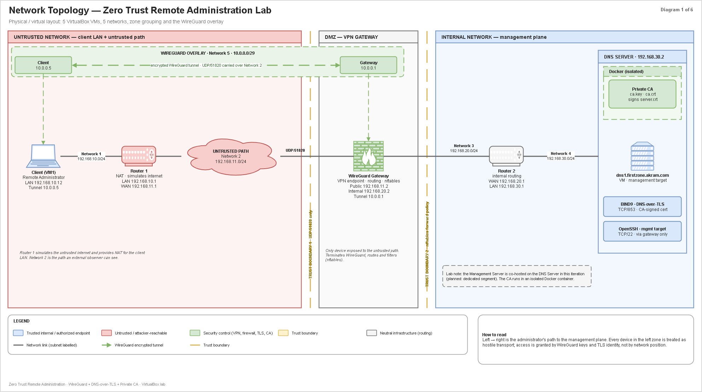
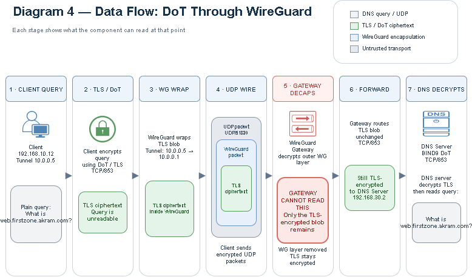

# Blind Gateway: Remote Administration Over WireGuard With End-to-End DNS Privacy

**WireGuard tunneling, DNS-over-TLS, and a self-hosted PKI: secure remote access to a private network, with DNS queries that even the VPN gateway cannot read.**

Technical report: [`docs/zero-trust-remote-administration-report.pdf`](docs/report.pdf)

---

## The problem

Administrators manage private infrastructure from networks they do not control: home Wi-Fi, hotels, coffee shops. Exposing SSH to the internet invites constant scanning. A conventional VPN secures the transport but requires trusting the gateway with all plaintext traffic, DNS included.

This project builds and tests an architecture that solves both problems:

1. Only an authenticated client can reach the private network. The gateway answers nothing else.
2. DNS queries are encrypted end to end between the client and the DNS server, so a compromised gateway cannot read them.

---

## What this project demonstrates

- **Reduced attack surface.** The WireGuard gateway is the only device exposed to the untrusted path, and it stays silent toward anything that is not an authenticated peer.
- **Gated management access.** SSH to the management target is reachable only through the tunnel.
- **Self-hosted PKI.** A Root CA, isolated in a Docker container with no network, issues the X.509 certificate used by the DNS server. No public CA is involved.
- **End-to-end DNS privacy.** DNS-over-TLS terminates at the DNS server. The gateway forwards the TLS stream but holds no key to read it.
- **Layered access control.** nftables policies on the gateway, the DNS server, and the routers enforce a defined access matrix.
- **Evidence over configuration.** Each security claim is tested by an experiment that produces a captured artifact.

---

## Architecture

Five virtual machines and one container, connected by four routed networks and one overlay.

| Machine | Role | Addresses |
|---|---|---|
| Client | Remote administrator (Ubuntu) | `192.168.10.12`, tunnel `10.0.0.1` |
| Router 1 | Simulates the internet, performs NAT | `192.168.10.1` (LAN), `192.168.11.1` (WAN) |
| WireGuard Gateway | VPN endpoint, routing, firewall; the only exposed device (Kali Linux) | `192.168.11.2` (public), `192.168.20.2` (internal), tunnel `10.0.0.2` |
| Router 2 | Internal routing, no NAT | `192.168.20.1` (WAN), `192.168.30.1` (LAN) |
| DNS Server | BIND9 with DNS-over-TLS, and the SSH management target | `192.168.30.2` |
| Certificate Authority | Private Root CA in an isolated Docker container on the DNS server | none (`--network none`) |

| Network | Subnet | Connects |
|---|---|---|
| 1, Client LAN | `192.168.10.0/24` | Client, Router 1 |
| 2, Untrusted path | `192.168.11.0/24` | Router 1, Gateway |
| 3, Internal | `192.168.20.0/24` | Gateway, Router 2 |
| 4, DNS network | `192.168.30.0/24` | Router 2, DNS Server |
| 5, WireGuard overlay | `10.0.0.0/29` | Client, Gateway |



Network topology. Logical roles: [`02-logical-architecture.png`](diagrams/png/02-logical-architecture.png).

---

## The Zero Trust property

No machine is trusted because of where it sits on the network. Every connection is authenticated cryptographically: the tunnel requires a known WireGuard key, and the DNS server must present a certificate signed by the project's CA. DNS queries travel inside two layers: TLS between the client and the DNS server, inside WireGuard between the client and the gateway.



| Adversary | Can observe | Cannot observe |
|---|---|---|
| External observer on the untrusted path | All WireGuard packets: addresses, sizes, timing | Tunnel contents, DNS queries |
| Compromised gateway | Decrypted tunnel traffic, connection metadata, the TLS server name | DNS query contents |

Threat model: [`03-threat-model.png`](diagrams/png/03-threat-model.png).

---

## Access control policy

Default deny everywhere; only the required flows are allowed ([`06-access-control-matrix.png`](diagrams/png/06-access-control-matrix.png)).

| Source | Gateway UDP/51820 | DNS server TCP/853 (DoT) | DNS server TCP/22 (SSH) | DNS server port 53 | Internet |
|---|---|---|---|---|---|
| Client (through the tunnel) | allow | allow | allow | deny | deny |
| External observer | deny | deny | deny | deny | deny |
| Routers | deny | deny | deny | deny | deny |

---

## Verification

22 experiments, in three groups, each with a folder of artifacts (pcap, screenshots, command output) in [`experiments/`](experiments/).

| # | Group | Experiments |
|---|---|---|
| 1 to 10 | Network and transport | Plaintext baseline, tunnel opacity, SSH trace, DNS visibility, port scan, unauthorized peer, wrong server key, AllowedIPs routing, routing table diff, packet structure |
| 11 to 16 | PKI | CA and server certificate inspection, chain verification, untrusted, mismatched-name, and expired certificates |
| 17 to 22 | DNS-over-TLS | Plain DNS vs DoT capture, gateway opacity, DoT through the tunnel, DoT without the tunnel, DoT without CA trust |

Commands and expected results: [`experiments/README.md`](experiments/README.md).

---

## Repository structure

```
configs/       Configuration files for every machine, with private keys removed
scripts/       PKI, WireGuard, verification, and helper scripts
experiments/   One folder per experiment, with its artifacts
diagrams/      Six diagrams: draw.io sources and PNG exports
docs/          The technical report (PDF)
troubleshooting.md   Problems met during the build, with causes and fixes
```

---

## Reproducing the project

1. **Machines and networks.** Create the five VMs and four VirtualBox internal networks, and assign the addresses above.
2. **Routing.**
   - Client: default route via `192.168.10.1`.
   - Router 1: `192.168.30.0/24` via `192.168.11.2`.
   - Gateway: `192.168.30.0/24` via `192.168.20.1`.
   - DNS server: default route via `192.168.30.1`.
   - Enable `net.ipv4.ip_forward=1` on both routers and the gateway.
3. **DNS.** Install BIND9 on the DNS server and copy [`configs/bind9/`](configs/bind9/) into `/etc/bind/`.
4. **Certificate Authority.** On the DNS server run `scripts/pki/01-create-ca.sh`, `02-issue-server-cert.sh`, and `03-install-server-cert.sh`. Copy `ca.crt` to the client and run `04-trust-ca-client.sh`.
5. **DNS-over-TLS.** Add the AppArmor rule from [`configs/apparmor/`](configs/apparmor/), restart `named`, then run `scripts/verify/check-dot.sh` from the client.
6. **WireGuard.** Generate keys with `scripts/wireguard/gen-keys.sh`, fill in [`configs/wireguard/`](configs/wireguard/), and run `wg-quick up wg0` on both ends.
7. **Firewall.** Load the rulesets from [`configs/nftables/`](configs/nftables/), then repeat the checks.
8. **Verify.** Run the experiments in [`experiments/`](experiments/).

---

## Limitations

- Endpoint compromise, private key theft, and operation at scale are out of scope.
- DNS-over-TLS hides query content. It does not hide that a connection exists, its addresses, volume, timing, or the TLS server name.
- The CA runs on the same host as the DNS server. A real deployment would keep it offline on a separate machine.
- The DNS server forwards external names to public resolvers over plain DNS. That leg is outside the threat model.
- DNSSEC validation is disabled because the VM clocks drift from real time.
- Router 1 reproduces a home or hotel router and is not a security control.
- Some VMs also have a VirtualBox NAT adapter, used only for installing packages. It is not part of the project's networks.

---

## Requirements

- VirtualBox, with enough resources for five VMs
- Linux VMs: Ubuntu, and Kali Linux for the gateway
- WireGuard, BIND 9.20, nftables, AppArmor
- OpenSSL and Docker (Certificate Authority)
- `tcpdump`, `tshark`/Wireshark, `kdig` (`knot-dnsutils`), `nmap`

---

## Author

Akram Khoulid, Networks and Telecommunications Engineering, ENSA, Université Cadi Ayyad.

## License

[MIT](LICENSE)
